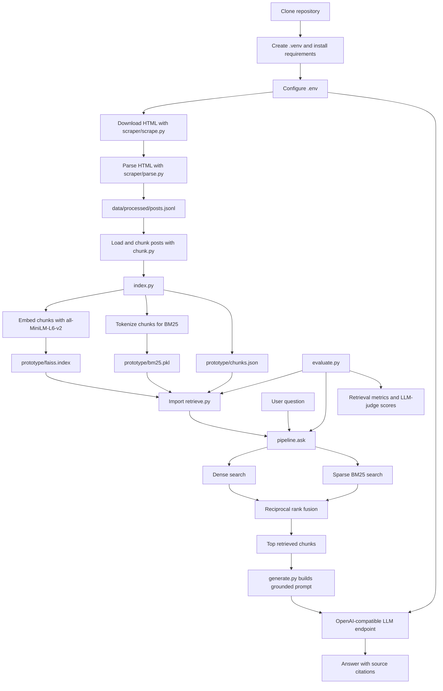

# AJATT RAG Prototype

This directory contains the retrieval-augmented generation (RAG) prototype for
the AJATT archive. It turns parsed blog posts into searchable chunks, retrieves
the most relevant chunks for a question, and asks an OpenAI-compatible language
model to answer using only those chunks.

The prototype is intentionally made up of small scripts instead of a web
service or a package. This keeps the indexing, retrieval, generation, and
evaluation stages easy to run independently, but it also means that commands
must be run from the repository root.

```bash
cd /path/to/AJATT
source .venv/bin/activate
```

## Architecture at a glance

The system has four logical stages:

1. **Ingestion**: `scraper/` downloads HTML and parses each post into JSONL.
2. **Indexing**: `chunk.py` cleans and chunks post bodies; `index.py` builds
   dense and sparse indexes.
3. **Question answering**: `retrieve.py` combines dense and sparse results,
   then `generate.py` prompts the configured LLM with the retrieved context.
4. **Evaluation**: `evaluate.py` compares retrieval strategies and uses an LLM
   judge to score generated answers.

## Setup and execution flow

The following diagram shows the normal first-run path. The scrape and index
stages produce persistent artifacts; later questions reuse those artifacts and
do not need to rebuild them unless the source data changes.



## Python files

### `config.py`

Centralizes configuration shared by the other modules:

- `DATA_PATH`: input JSONL path.
- `CHUNK_SIZE` and `CHUNK_OVERLAP`: chunking limits in words.
- `EMBED_MODEL`: Hugging Face sentence-transformer model used for embeddings.
- `TOP_K`: default number of retrieved chunks.
- `LLM_BASE_URL`, `LLM_MODEL`, and `OPENAI_API_KEY`: LLM client settings.

Paths are relative to the current working directory, which is why the
repository-root requirement matters. `load_dotenv()` reads `.env` before the
environment values are used.

### `chunk.py`

Transforms post records into retrieval-ready chunks.

- `normalize_text(text)` removes control characters and collapses whitespace.
- `split_into_sentences(text)` uses a deliberately simple regular expression
  that splits after `.`, `!`, or `?` when the next character looks like the
  start of a sentence.
- `chunk_text(text, size, overlap)` accumulates whole sentences until the
  configured word limit is reached, then carries recent sentences into the
  next chunk. Sentence boundaries avoid cutting most prose in the middle.
- `load_and_chunk(path)` reads JSONL records and attaches stable metadata to
  every chunk: `chunk_id`, `slug`, `url`, `title`, `author`, `categories`,
  `chunk_index`, and `text`.

The default 200-word overlap preserves context across chunk boundaries, while
the 512-word size keeps individual retrieval results manageable for the LLM
prompt.

### `index.py`

Builds both retrieval indexes from `load_and_chunk()`:

1. It encodes every chunk with the sentence-transformer model.
2. It normalizes embeddings and stores them in a FAISS
   `IndexFlatIP` index. Inner product on normalized vectors is cosine
   similarity, giving a simple exact dense search implementation.
3. It lowercases and whitespace-tokenizes each chunk for `BM25Okapi`.
4. It pickles the BM25 object together with its chunk records.
5. It writes `chunks.json` for inspection and independent lookup.

The dense and sparse indexes deliberately use different signals. Dense
embeddings capture semantic similarity, while BM25 is useful for exact words,
names, and terminology. Keeping both allows retrieval to work when a question
uses either similar wording or a precise archive term.

### `retrieve.py`

Loads the model and index artifacts once at module import, then exposes three
retrieval functions:

- `retrieve(query, top_k=10, dense_k=50, sparse_k=50)` performs dense and
  sparse searches, fuses their ranked chunk IDs, and returns copied chunk
  records with an `rrf_score`.
- `dense_only(query, top_k=10)` is used for evaluation and returns only FAISS
  results.
- `sparse_only(query, top_k=10)` is used for evaluation and returns only BM25
  results.

`rrf(rank_lists, k=60)` implements reciprocal rank fusion (RRF). A chunk gets
`1 / (k + rank)` from each ranking in which it appears; the contributions are
added and sorted. RRF is used instead of trying to calibrate incomparable
dense-similarity and BM25 scores.

### `generate.py`

Owns the OpenAI-compatible LLM interaction:

- Creates an `OpenAI` client using the configured base URL and API key.
- `call_llm(prompt)` sends one user message with `temperature=0.0` and raises
  if the endpoint returns no content.
- `build_context(chunks)` formats titles, URLs, categories, and text for the
  prompt.
- `generate_answer(question, chunks)` creates the grounded instruction prompt.
  The prompt tells the model to use only retrieved excerpts, cite source posts,
  frame claims as AJATT guidance, and refuse when the excerpts are insufficient.

This is the generation half of RAG. The model does not search the archive
itself; it only receives the context assembled by the retrieval stage.

### `pipeline.py`

Provides the application-level `ask(question, top_k=10)` function:

1. Call `retrieve()` for relevant chunks.
2. Return a local `"No relevant passages found."` result if retrieval is empty.
3. Pass the chunks to `generate_answer()`.
4. Return the generated answer and the retrieved source records.

When run as a script, it asks five sample questions and prints the answer plus
the first three sources for each question.

### `evaluate.py`

Evaluates retrieval and answer generation from `prototype/eval_questions.json`.
Each item normally contains an `id`, `question`, `gold_slugs`, and `split`
(`dev` or `test`). An item may instead set `expected_refusal` when it should
not have a matching source post.

Retrieval evaluation:

- `post_level_hit()` finds the rank of the first chunk from any gold post.
- `score_retrieval()` calculates Hit@1, Hit@3, Hit@5, Hit@10, and mean
  reciprocal rank (MRR), skipping expected-refusal items.
- The main routine reports these metrics for dense-only, sparse-only, and
  hybrid-RRF retrieval.

Generation evaluation:

- `score_generation()` runs the normal `ask()` path for each item.
- `judge()` sends the question, retrieved context, and answer to a second LLM
  prompt that requests JSON scores.
- It reports average faithfulness, average relevance, and expected-refusal
  accuracy, plus a short per-question table.

Run all items or one split:

```bash
python prototype/evaluate.py
python prototype/evaluate.py --split test
```

Evaluation requires both working indexes and a reachable LLM endpoint. It may
make many model requests: one set for generated answers and additional requests
for the judge scores.

## Design choices and limitations

- **JSONL as the interchange format**: one post per line is stream-friendly,
  easy to inspect, and avoids requiring a database for a static archive.
- **Sentence-based word chunks**: this preserves prose context and uses
  overlap to reduce boundary loss, but the sentence splitter is optimized for
  English and is not a full natural-language parser.
- **Hybrid retrieval**: dense search handles paraphrases; BM25 handles exact
  terms. RRF combines ranks without assuming their raw scores are comparable.
- **Local artifact files**: FAISS, pickle, and JSON make the prototype quick to
  rebuild and use, but they are not a multi-user index service. The pickle
  artifact should only be loaded from a trusted source.
- **Import-time loading**: retrieval is fast for repeated questions after
  startup, but importing the module is expensive and fails if the model or
  index files are unavailable.
- **Grounded generation prompt**: citation and refusal behavior is requested
  from the LLM rather than enforced by a post-processing validator. The answer
  should therefore be treated as model output and checked against its cited
  excerpts when accuracy matters.
